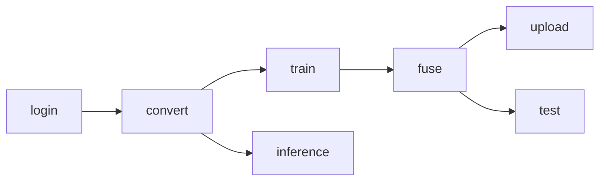

# Gemma3 Fine-Tuning CLI

Command-line interface for fine-tuning Google's Gemma 3 models on Apple Silicon using [MLX](https://github.com/ml-explore/mlx). The pipeline covers the full workflow from model conversion through training, fusion, and deployment.

## Pipeline Flow



## Commands

| Command     | Description                                                                                          |
| ----------- | ---------------------------------------------------------------------------------------------------- |
| `login`     | Create the local cache directory and authenticate with Hugging Face Hub.                             |
| `convert`   | Download a Hugging Face model and convert it to MLX format, with optional quantization.              |
| `train`     | Run the full training pipeline: convert, load model, apply LoRA adapters, load data, and train.      |
| `fuse`      | Merge trained LoRA adapter weights back into the base MLX model.                                     |
| `upload`    | Push the fused model directory to a Hugging Face Hub repository.                                     |
| `test`      | Load the fused model and run a smoke-test inference with the prompt `"Hello, world!"`.               |
| `inference` | Run inference on the base converted model (before fine-tuning) with a user-supplied prompt.          |

## Configuration

All settings are managed through `PipelineConfig` ([pydantic-settings](https://docs.pydantic.dev/latest/concepts/pydantic_settings/)). Override any value by setting an environment variable with the appropriate section prefix.

### `MODEL_*` -- Model settings

| Variable           | Default                          | Description                        |
| ------------------ | -------------------------------- | ---------------------------------- |
| `MODEL_MODEL_NAME` | `google/functiongemma-270m-it`   | Hugging Face model identifier      |
| `MODEL_QUANTIZE`   | `true`                           | Enable weight quantization         |
| `MODEL_DTYPE`      | `float16`                        | Data type for conversion           |
| `MODEL_Q_BITS`     | `4`                              | Quantization bit width             |
| `MODEL_MLX_PATH`   | `./<short_name>-mlx` (derived)   | Output path for converted model    |
| `MODEL_CACHE_DIR`  | `./models_cache`                 | Local cache directory for downloads|

### `LORA_*` -- LoRA adapter settings

| Variable            | Default                          | Description                        |
| ------------------- | -------------------------------- | ---------------------------------- |
| `LORA_NUM_LAYERS`   | `4`                              | Number of layers to adapt          |
| `LORA_RANK`         | `4`                              | LoRA rank                          |
| `LORA_SCALE`        | `20.0`                           | LoRA scaling factor                |
| `LORA_DROPOUT`      | `0.0`                            | Dropout rate (0.0 -- 1.0)          |
| `LORA_ADAPTER_PATH` | `adapters-<short_name>` (derived)| Directory for adapter weights      |

### `TRAINING_*` -- Training hyperparameters

| Variable                  | Default | Description                              |
| ------------------------- | ------- | ---------------------------------------- |
| `TRAINING_BATCH_SIZE`     | `1`     | Training batch size                      |
| `TRAINING_ITERS`          | `200`   | Total training iterations                |
| `TRAINING_STEPS_PER_EVAL` | `50`    | Evaluation frequency (in steps)          |
| `TRAINING_GRAD_CHECKPOINT`| `true`  | Enable gradient checkpointing            |
| `TRAINING_LEARNING_RATE`  | `1e-5`  | Optimizer learning rate                  |

### `DATA_*` -- Dataset settings

| Variable                 | Default                  | Description                          |
| ------------------------ | ------------------------ | ------------------------------------ |
| `DATA_HF_DATASET_PATH`  | `google/mobile-actions`  | Hugging Face dataset identifier      |
| `DATA_TRAIN_SPLIT`       | `train[:70%]`            | Training split specifier             |
| `DATA_VALID_SPLIT`       | `train[-10%:]`           | Validation split specifier           |
| `DATA_PROMPT_FEATURE`    | `prompt`                 | Dataset column for input prompts     |
| `DATA_COMPLETION_FEATURE`| `response`               | Dataset column for target completions|

### `FUSE_*` -- Fusion settings

| Variable         | Default                        | Description                        |
| ---------------- | ------------------------------ | ---------------------------------- |
| `FUSE_FUSE_PATH` | `./<short_name>-new` (derived) | Output path for the fused model    |

### `UPLOAD_*` -- Upload settings

| Variable         | Default                             | Description                          |
| ---------------- | ----------------------------------- | ------------------------------------ |
| `UPLOAD_REPO_ID` | `deimagjas/<short_name>-mlx` (derived) | Hugging Face Hub repository ID    |

## Dynamic Path Derivation

Several paths are automatically derived from `MODEL_MODEL_NAME` so you only need to set the model identifier. The **short name** is extracted by taking the part after the last `/` in the model name.

For example, with the default `google/functiongemma-270m-it`:

| Setting              | Derived value                              |
| -------------------- | ------------------------------------------ |
| `MODEL_MLX_PATH`     | `./functiongemma-270m-it-mlx`              |
| `LORA_ADAPTER_PATH`  | `adapters-functiongemma-270m-it`           |
| `FUSE_FUSE_PATH`     | `./functiongemma-270m-it-new`              |
| `UPLOAD_REPO_ID`     | `deimagjas/functiongemma-270m-it-mlx`      |

If you set `MODEL_MODEL_NAME=meta-llama/Llama-3-8B`, the derived paths become:

| Setting              | Derived value                    |
| -------------------- | -------------------------------- |
| `MODEL_MLX_PATH`     | `./Llama-3-8B-mlx`              |
| `LORA_ADAPTER_PATH`  | `adapters-Llama-3-8B`           |
| `FUSE_FUSE_PATH`     | `./Llama-3-8B-new`              |
| `UPLOAD_REPO_ID`     | `deimagjas/Llama-3-8B-mlx`      |

Any derived path can be overridden explicitly by setting its environment variable.

## Usage Examples

### Via Make targets

```bash
make login                          # authenticate with Hugging Face
make convert                        # convert HF model to MLX format
make train                          # run full training pipeline
make fuse                           # merge LoRA adapters into base model
make upload                         # push fused model to HF Hub
make test                           # smoke-test the fused model
make inference PROMPT="Explain gravity"  # run inference on base model
make all                            # run: setup, login, convert, train, fuse, test
make clean                          # remove generated model directories
```

### Via Python directly

```bash
python cli.py login
python cli.py convert
python cli.py train
python cli.py fuse
python cli.py upload
python cli.py test
python cli.py inference "Explain gravity"
```

### With custom configuration

```bash
# Use a different model and increase training iterations
MODEL_MODEL_NAME=google/gemma-3-1b-it TRAINING_ITERS=500 make train

# Override the LoRA rank and learning rate
LORA_RANK=8 TRAINING_LEARNING_RATE=2e-5 python cli.py train

# Upload to a custom repository
UPLOAD_REPO_ID=myuser/my-finetuned-model make upload
```
